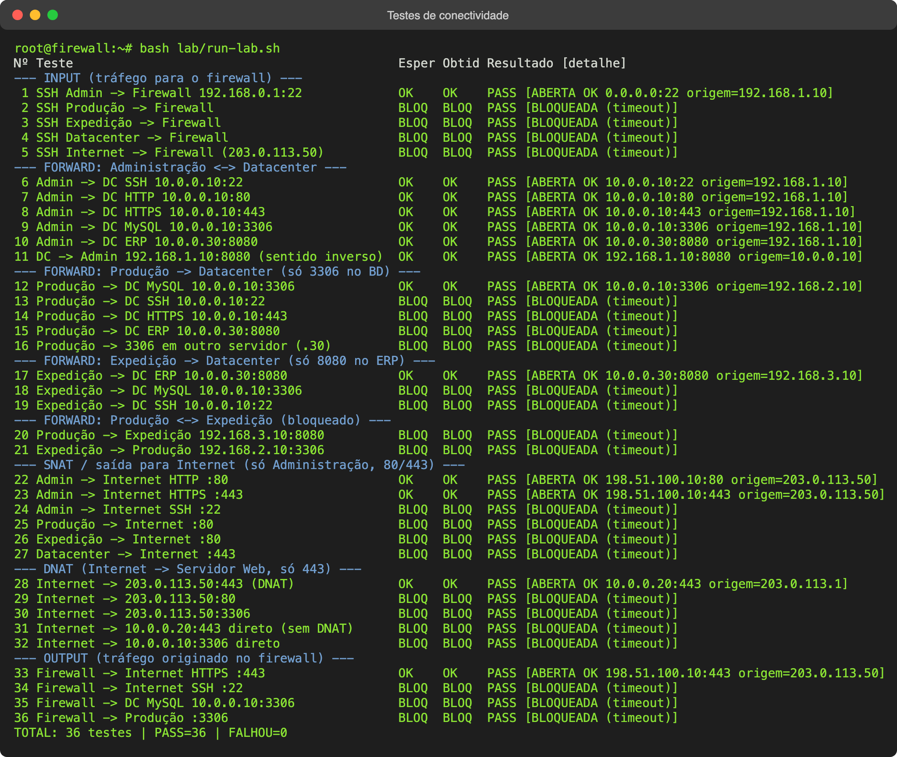
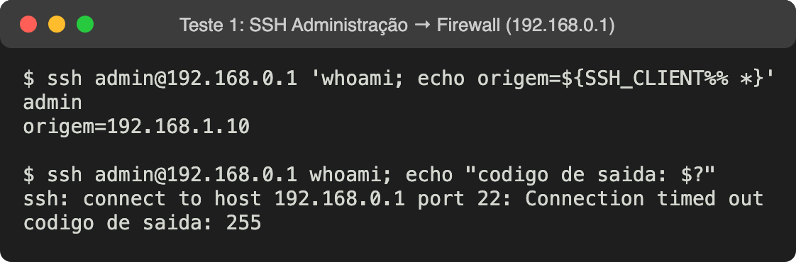
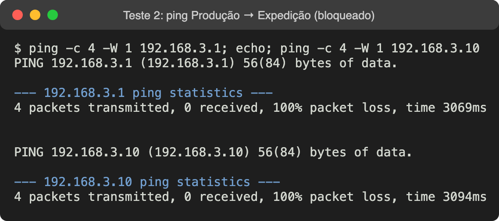
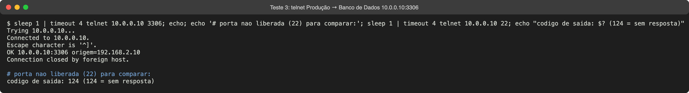
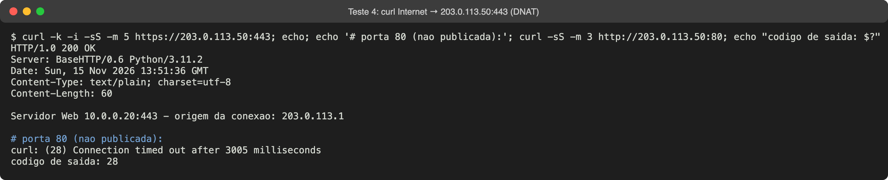
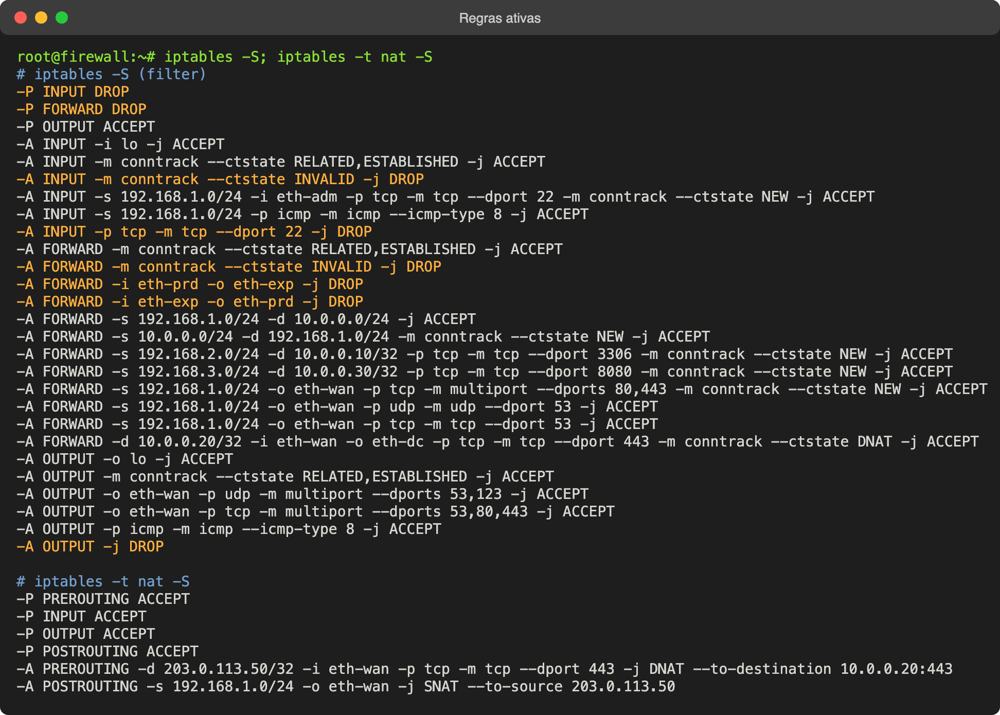
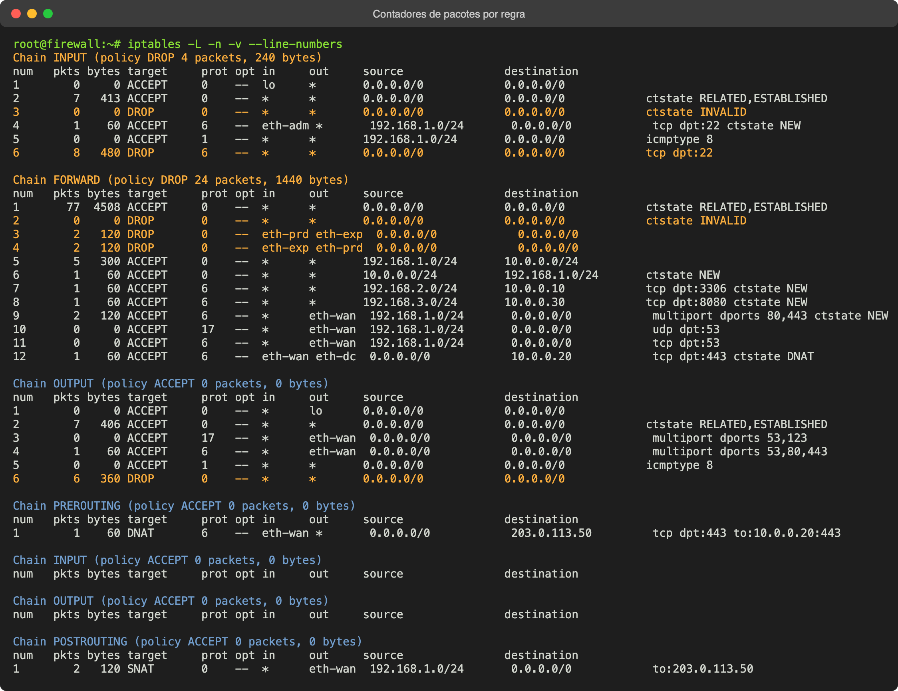
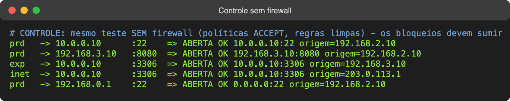

# Relatório Técnico: Implementação de Firewall Industrial com iptables

## 1. Contexto Operacional e Topologia de Rede

Este documento descreve a segmentação de rede e o firewall perimetral de uma indústria de manufatura, implementado com iptables e validado em laboratório.

### Segmentos de rede

- **Rede de Administração (`192.168.1.0/24`):** estações corporativas (RH, Financeiro, Diretoria).
- **Rede de Produção (`192.168.2.0/24`):** máquinas CNC, sistemas SCADA e PLCs.
- **Rede de Expedição (`192.168.3.0/24`):** estoque e emissão de notas fiscais.
- **Datacenter Interno (`10.0.0.0/24`):** banco de dados (`10.0.0.10`), servidor Web (`10.0.0.20`), ERP (`10.0.0.30`) e backup.
- **Firewall central:** interface interna `192.168.0.1`, interface externa `203.0.113.50`.

> Os IPs `10.0.0.20` (Web) e `10.0.0.30` (ERP) são suposições do projeto. O enunciado só define o banco em `10.0.0.10`.

### Matriz de controle de tráfego

| Origem | Destino | Serviço / Porta | Ação | Justificativa |
|---|---|---|---|---|
| Administração | Firewall | SSH (TCP 22) | PERMITIR | Gerência do firewall |
| Administração | Datacenter | Qualquer | PERMITIR | Acesso de gestão aos servidores |
| Administração | Internet | HTTP/HTTPS (80, 443) | PERMITIR (SNAT) | Navegação corporativa com mascaramento |
| Produção | Datacenter (`10.0.0.10`) | MySQL (TCP 3306) | PERMITIR | Envio de dados de CNC/PLCs ao banco |
| Produção | Expedição | Qualquer | BLOQUEAR | Isolamento entre planta e logística |
| Expedição | Datacenter (`10.0.0.30`) | ERP (TCP 8080) | PERMITIR | Notas e estoque |
| Expedição | Produção | Qualquer | BLOQUEAR | Evita movimentação lateral |
| Internet | Servidor Web (`10.0.0.20`) | HTTPS (TCP 443) | PERMITIR (DNAT) | Publicação do serviço Web |

---

## 2. Script de Implementação (`firewall_industria.sh`)

```bash
#!/bin/bash
# Script de Configuração de Firewall - Indústria XYZ
# Firewall central: 192.168.0.1 (interna) / 203.0.113.50 (internet)

# ===== VARIÁVEIS (ajuste ao seu ambiente) =====
ADMIN="192.168.1.0/24"      # Rede de Administração
PROD="192.168.2.0/24"       # Rede de Produção (CNC, SCADA, PLCs)
EXPED="192.168.3.0/24"      # Rede de Expedição
DC="10.0.0.0/24"            # Datacenter interno
DB_SRV="10.0.0.10"          # Servidor de banco de dados (MySQL) - conforme teste 3
ERP_SRV="10.0.0.30"         # Servidor ERP (suposição - ajuste se necessário)
WEB_SRV="10.0.0.20"         # Servidor Web (suposição - ajuste se necessário)
FW_PUB="203.0.113.50"       # IP público do firewall
WAN_IF="${WAN_IF:-eth0}"    # Interface ligada à internet (ajuste: eth0/ens33...)
IF_ADM="${IF_ADM:-eth1}"    # Interface da rede de Administração
IF_PRD="${IF_PRD:-eth2}"    # Interface da rede de Produção
IF_EXP="${IF_EXP:-eth3}"    # Interface da rede de Expedição
IF_DC="${IF_DC:-eth4}"      # Interface do Datacenter

# Habilitar roteamento (necessário para FORWARD/NAT)
echo 1 > /proc/sys/net/ipv4/ip_forward

# Limpar regras anteriores
iptables -F
iptables -X
iptables -t nat -F
iptables -t nat -X

# Definir políticas padrão
iptables -P INPUT DROP      # Nada entra no firewall sem permissão
iptables -P FORWARD DROP    # Nada atravessa o firewall sem permissão
iptables -P OUTPUT ACCEPT   # Firewall pode originar tráfego (refinado abaixo)

# ===== REGRAS INPUT (Tráfego para o Firewall) =====
# Loopback: comunicação interna do próprio firewall
iptables -A INPUT -i lo -j ACCEPT
# Respostas de conexões já estabelecidas / relacionadas
iptables -A INPUT -m conntrack --ctstate ESTABLISHED,RELATED -j ACCEPT
# Descarta pacotes inválidos
iptables -A INPUT -m conntrack --ctstate INVALID -j DROP
# SSH ao firewall: SOMENTE da rede de Administração
iptables -A INPUT -i $IF_ADM -p tcp -s $ADMIN --dport 22 -m conntrack --ctstate NEW -j ACCEPT
# Ping ao firewall apenas da Administração (diagnóstico)
iptables -A INPUT -p icmp --icmp-type echo-request -s $ADMIN -j ACCEPT
# Qualquer outra tentativa de SSH (Produção, Expedição, DC, Internet) é descartada
iptables -A INPUT -p tcp --dport 22 -j DROP
# (o restante cai na política DROP)

# ===== REGRAS FORWARD (Tráfego entre Redes) =====
# Respostas de conexões já autorizadas (permite o retorno em ambos os sentidos)
iptables -A FORWARD -m conntrack --ctstate ESTABLISHED,RELATED -j ACCEPT
iptables -A FORWARD -m conntrack --ctstate INVALID -j DROP

# Produção <-> Expedição: BLOQUEADO (segurança operacional), nos dois sentidos
iptables -A FORWARD -i $IF_PRD -o $IF_EXP -j DROP
iptables -A FORWARD -i $IF_EXP -o $IF_PRD -j DROP

# Administração -> Datacenter: acesso total (SSH, HTTP, HTTPS, banco de dados)
iptables -A FORWARD -s $ADMIN -d $DC -j ACCEPT
# Datacenter -> Administração: sentido inverso (Admin <-> DC), apenas novas conexões iniciadas pelo DC
iptables -A FORWARD -s $DC -d $ADMIN -m conntrack --ctstate NEW -j ACCEPT

# Produção -> Datacenter: somente leitura de dados (MySQL 3306) no servidor de BD
iptables -A FORWARD -s $PROD -d $DB_SRV -p tcp --dport 3306 -m conntrack --ctstate NEW -j ACCEPT

# Expedição -> Datacenter: acesso ao ERP (porta 8080)
iptables -A FORWARD -s $EXPED -d $ERP_SRV -p tcp --dport 8080 -m conntrack --ctstate NEW -j ACCEPT

# Saída para Internet: SOMENTE Administração (HTTP/HTTPS + DNS para resolver nomes)
iptables -A FORWARD -s $ADMIN -o $WAN_IF -p tcp -m multiport --dports 80,443 -m conntrack --ctstate NEW -j ACCEPT
iptables -A FORWARD -s $ADMIN -o $WAN_IF -p udp --dport 53 -j ACCEPT
iptables -A FORWARD -s $ADMIN -o $WAN_IF -p tcp --dport 53 -j ACCEPT

# Internet -> Servidor Web do DC: apenas HTTPS 443 e SOMENTE tráfego que passou pelo DNAT
# (--ctstate DNAT impede acesso direto a 10.0.0.20 sem passar pelo IP público)
iptables -A FORWARD -i $WAN_IF -o $IF_DC -d $WEB_SRV -p tcp --dport 443 -m conntrack --ctstate DNAT -j ACCEPT

# Todo o resto (ex.: Produção/Expedição -> Internet) cai na política DROP

# ===== REGRAS OUTPUT (Tráfego do Firewall) =====
# Loopback
iptables -A OUTPUT -o lo -j ACCEPT
# Respostas de conexões estabelecidas (ex.: resposta do SSH da Administração)
iptables -A OUTPUT -m conntrack --ctstate ESTABLISHED,RELATED -j ACCEPT
# Firewall pode resolver nomes (DNS) e sincronizar hora (NTP) / atualizar (HTTP/HTTPS) na internet
iptables -A OUTPUT -o $WAN_IF -p udp -m multiport --dports 53,123 -j ACCEPT
iptables -A OUTPUT -o $WAN_IF -p tcp -m multiport --dports 53,80,443 -j ACCEPT
# Diagnóstico: ping originado no firewall
iptables -A OUTPUT -p icmp --icmp-type echo-request -j ACCEPT
# Todo o restante originado no firewall é descartado (inclui novas conexões para
# Produção, Expedição e Datacenter), mantendo -P OUTPUT ACCEPT exigido pelo template
iptables -A OUTPUT -j DROP

# ===== REGRAS SNAT (Mascaramento para Internet) =====
# Tráfego da Administração (única rede com saída) sai com o IP público do firewall
iptables -t nat -A POSTROUTING -s $ADMIN -o $WAN_IF -j SNAT --to-source $FW_PUB

# ===== REGRAS DNAT (Redirecionamento de Entrada) =====
# Internet -> 203.0.113.50:443 é redirecionado para o servidor web interno
iptables -t nat -A PREROUTING -i $WAN_IF -d $FW_PUB -p tcp --dport 443 -j DNAT --to-destination $WEB_SRV:443

# Salvar regras
RULES_FILE="${RULES_FILE:-/etc/iptables/rules.v4}"
mkdir -p "$(dirname "$RULES_FILE")"
iptables-save > "$RULES_FILE"
echo "Firewall aplicado. Regras salvas em $RULES_FILE"
```

---

## 3. Análise Técnica por Tipo de Regra

### 3.1 INPUT
- **Função:** controla o tráfego destinado ao próprio firewall.
- **Regras:** política `DROP`; aceita loopback e respostas de conexões já estabelecidas; aceita SSH somente da rede de Administração (`192.168.1.0/24`) pela interface `eth1`. Qualquer outro SSH é descartado.
- **Evidência:** testes 1 a 5 (Figura 5). O contador das regras aparece na Figura 7.

### 3.2 FORWARD
- **Função:** controla o tráfego entre as redes internas e para a Internet.
- **Regras:** política `DROP`; bloqueio explícito Produção ↔ Expedição por interface, nos dois sentidos; Administração → Datacenter liberada; Produção → `10.0.0.10:3306`; Expedição → `10.0.0.30:8080`; Administração → Internet apenas em 80/443 (e DNS); Internet → `10.0.0.20:443` somente se o pacote passou pelo DNAT (`--ctstate DNAT`).
- **Evidência:** testes 6 a 21 (Figura 5).

### 3.3 OUTPUT
- **Função:** controla o tráfego originado no próprio firewall.
- **Regras:** aceita loopback, respostas de conexões estabelecidas, DNS/NTP e HTTP/HTTPS para a Internet, e ping. Todo o resto é descartado pela regra final `OUTPUT -j DROP`. Assim, o firewall não inicia conexões para Produção, Expedição ou Datacenter.
- **Evidência:** testes 33 a 36 (Figura 5).

### 3.4 SNAT
- **Função:** mascara a origem do tráfego interno que sai para a Internet.
- **Regra:** `-t nat -A POSTROUTING -s 192.168.1.0/24 -o eth0 -j SNAT --to-source 203.0.113.50`.
- **Evidência:** nos testes 22 e 23, o servidor da Internet registra `origem=203.0.113.50`, e não o IP interno `192.168.1.10`.

### 3.5 DNAT
- **Função:** publica o servidor Web interno.
- **Regra:** `-t nat -A PREROUTING -i eth0 -d 203.0.113.50 -p tcp --dport 443 -j DNAT --to-destination 10.0.0.20:443`.
- **Evidência:** o teste 28 mostra a conexão a `203.0.113.50:443` chegando em `10.0.0.20:443`. Os testes 29 a 32 mostram que as portas 80 e 3306 e o acesso direto a `10.0.0.20` ficam bloqueados.

---

## 4. Validação Prática

### 4.1 Ambiente de teste

O firewall foi testado em um laboratório com 6 *network namespaces* Linux dentro de um contêiner Docker: firewall, Administração, Produção, Expedição, Datacenter e Internet. Cada namespace tem seus IPs e serviços TCP de teste nas portas relevantes. O script da seção 2 foi aplicado **sem alterações**, apenas com os nomes das interfaces ajustados por variáveis de ambiente.

| Rede | Host de teste | Serviços |
|---|---|---|
| Administração | `192.168.1.10` | 8080 |
| Produção | `192.168.2.10` | 3306 |
| Expedição | `192.168.3.10` | 8080 |
| Datacenter | `10.0.0.10`, `.20`, `.30` | 22, 80, 443, 3306, 8080 |
| Internet | `198.51.100.10` (site externo), `203.0.113.1` (cliente) | 22, 80, 443 |

Cada teste abre uma conexão TCP de um host de origem para um IP e uma porta de destino. O resultado é `ABERTA` (conexão aceita; o servidor informa o IP de origem que viu) ou `BLOQUEADA (timeout)` (pacote descartado pelo firewall).

### 4.2 Resultado geral

**36 testes executados, 36 aprovados, 0 falhas.** Cada linha compara o resultado esperado (`OK` ou `BLOQ`) com o obtido.



*Figura 5: testes de conectividade (36/36 aprovados).*

### 4.3 Testes do enunciado (comandos reais)

Os quatro testes pedidos no enunciado foram executados com as ferramentas reais, com o firewall ativo. No laboratório, o firewall roda um `sshd` (usuário `admin`, autenticação por chave) e o servidor Web `10.0.0.20` responde HTTPS com certificado autoassinado. Por isso o `curl` usa `-k`.

**Teste 1: SSH da Administração para o firewall (deve funcionar)**

`ssh admin@192.168.0.1` a partir da Administração (`192.168.1.10`). O mesmo comando a partir da Produção expira.



*Figura 1: a Administração entra no firewall e o servidor vê a origem `192.168.1.10`. A Produção recebe `Connection timed out`.*

**Teste 2: ping Produção → Expedição (deve bloquear)**

`ping 192.168.3.1` (interface do firewall na Expedição) e `ping 192.168.3.10` (host da Expedição), a partir da Produção (`192.168.2.10`).



*Figura 2: `4 packets transmitted, 0 received, 100% packet loss` nos dois destinos.*

**Teste 3: telnet Produção → Banco de Dados na porta 3306 (deve funcionar)**

`telnet 10.0.0.10 3306` a partir da Produção. Para comparação, a porta 22 do mesmo servidor.



*Figura 3: conexão estabelecida na porta 3306 (`Connected to 10.0.0.10`, origem `192.168.2.10`). A porta 22 não responde (código de saída 124 do `timeout`).*

**Teste 4: acesso externo ao servidor Web na porta 443 (deve funcionar)**

`curl -k -i https://203.0.113.50:443` a partir da Internet (`203.0.113.1`). Para comparação, `curl http://203.0.113.50:80`.



*Figura 4: `HTTP/1.0 200 OK` respondido pelo servidor interno `10.0.0.20:443`, acessado pelo IP público. A porta 80 expira (`Connection timed out`).*

### 4.4 Testes por requisito

| ID | Requisito | Origem → Destino | Esperado | Obtido | Linha na Fig. 5 |
|---|---|---|---|---|---|
| T1 | SSH ao firewall só da Administração | Admin → `192.168.0.1:22` | Aberta | Aberta | 1 |
| T1b | SSH de outras redes bloqueado | Produção, Expedição, DC, Internet → firewall:22 | Bloqueada | Bloqueada | 2 a 5 |
| T2 | Produção ↔ Expedição bloqueado | `192.168.2.10` ↔ `192.168.3.10` | Bloqueada | Bloqueada | 20, 21 |
| T3 | Produção lê o banco | Produção → `10.0.0.10:3306` | Aberta | Aberta | 12 |
| T3b | Produção não acessa outros serviços | Produção → SSH, HTTPS, ERP, 3306 em `.30` | Bloqueada | Bloqueada | 13 a 16 |
| T4 | Publicação externa via DNAT | Internet → `203.0.113.50:443` | Aberta (chega em `10.0.0.20`) | Aberta | 28 |
| T4b | Só 443 é publicada | Internet → `:80`, `:3306`, `10.0.0.20:443` direto | Bloqueada | Bloqueada | 29 a 32 |
| T5 | Expedição só acessa o ERP | Expedição → `10.0.0.30:8080` | Aberta | Aberta | 17 |
| T5b | Expedição não acessa o banco | Expedição → `10.0.0.10:3306` e `:22` | Bloqueada | Bloqueada | 18, 19 |
| T6 | Navegação da Administração com SNAT | Admin → `198.51.100.10:80/443` | Aberta com origem `203.0.113.50` | Aberta com origem `203.0.113.50` | 22, 23 |
| T6b | Só a Administração sai | Produção, Expedição, DC → Internet; Admin → `:22` | Bloqueada | Bloqueada | 24 a 27 |
| T7 | Admin ↔ Datacenter total | Admin → DC (22, 80, 443, 3306, 8080) e DC → Admin | Aberta | Aberta | 6 a 11 |
| T8 | OUTPUT do firewall | Firewall → Internet 443 (aberta); → Internet 22, DC, Produção (bloqueadas) | Conforme regra | Conforme regra | 33 a 36 |

### 4.5 Regras ativas



*Figura 6: regras ativas no firewall, tabelas filter e nat.*

### 4.6 Contadores de pacotes

Os contadores mostram quantos pacotes cada regra processou durante os testes. Regras de `DROP` com contador maior que zero provam que o bloqueio foi feito por elas.



*Figura 7: contadores de pacotes e bytes por regra.*

### 4.7 Controle sem firewall

Para provar que os bloqueios vêm das regras, os mesmos acessos foram repetidos com as regras apagadas e as políticas em `ACCEPT`. Todos passaram a funcionar (o SSH da Produção ao datacenter aparece como `RECUSADA`, pois o serviço de teste na porta 22 já foi encerrado, mas o pacote chega ao host), incluindo Produção → Expedição e Internet → banco de dados.



*Figura 8: controle sem firewall.*

---

## 5. Conclusão

O firewall aplicou os requisitos de segmentação da indústria: política padrão `DROP` em INPUT e FORWARD, filtragem por estado de conexão e bloqueio entre Produção e Expedição. Nos 36 cenários testados, o comportamento obtido foi igual ao esperado. O SNAT mascarou a saída da Administração com `203.0.113.50`, e o DNAT publicou apenas o HTTPS do servidor Web interno.

**Limitações:**
- Os testes verificam conectividade TCP em ambiente virtual, não aplicações reais (SSH, MySQL, HTTPS).
- Os IPs do servidor Web (`10.0.0.20`) e do ERP (`10.0.0.30`) foram assumidos.
- Não foi verificada conformidade formal com a norma IEC 62443.

---

## 6. Como reproduzir os testes

Requisito: Docker. As regras são aplicadas apenas dentro de namespaces de rede no contêiner e não alteram o computador do usuário.

```bash
git clone https://github.com/SEU_USUARIO/trabalho_iptables.git
cd trabalho_iptables
docker build -t firewall-lab .
docker run --rm --privileged -v "$PWD/lab/evidencias:/work/lab/evidencias" firewall-lab
```

A execução imprime os 36 testes e grava os resultados em `lab/evidencias/` (`01-testes.txt`, `03-regras.txt`, `04-contadores.txt`, `06-controle-sem-firewall.txt` e `rules.v4`). A opção `--privileged` é necessária para criar os namespaces de rede.

Repositório: https://github.com/SEU_USUARIO/trabalho_iptables
